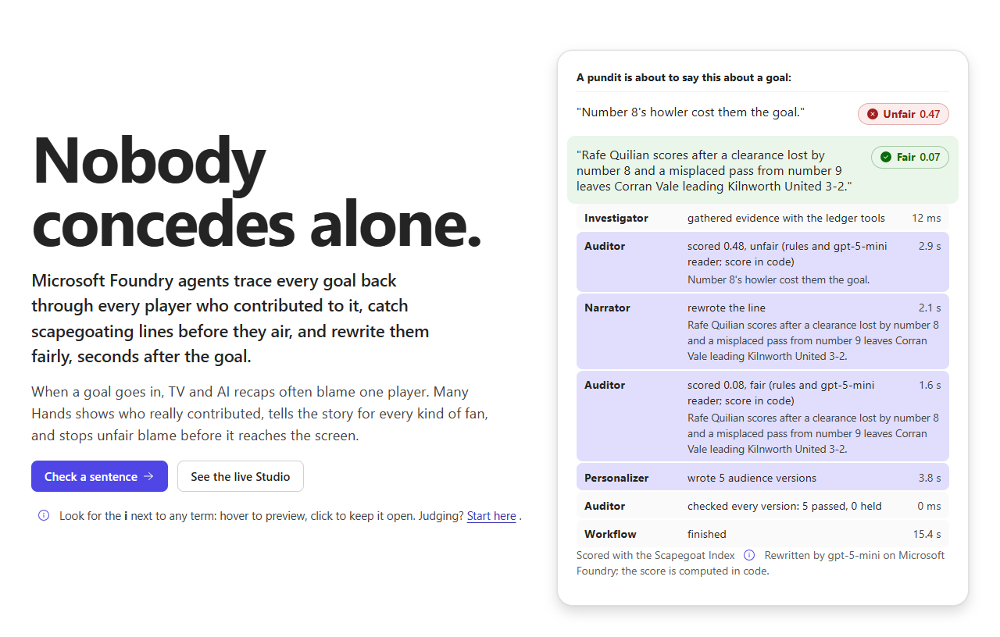

# Many Hands

**Microsoft Foundry agents trace every goal back through every player who contributed to it, catch scapegoating lines before they air, and have a fair line ready about 3 seconds after the goal.**

> **A pundit is about to say:** "Number 8's howler cost them the goal."  **Unfair**
> **Many Hands puts on air:** "A loose clearance by number 8 and a misplaced pass from number 9 led to Rafe Quilian's goal."  **Fair**



**Live:** https://ca-manyhands-7kzrrno7qr6zo.orangedune-9d42108b.eastus2.azurecontainerapps.io · Judges: open **Judges start here** in the header for a three-minute path.

| On a match day | |
|---|---|
| **About 3 s** | from a goal reaching Azure Event Hubs to a fair, checked line ready for air (medians of 2.9 s and 3.2 s on two live runs of 14 goals each, two matches at once; the slowest took 7.2 s). All five audience versions follow by 7.7 s. |
| **$4.91 a season** | model cost to check every goal of a 380-match season, about 1.3 cents a match, from the tokens each agent call actually used |
| **77% right** | when the check calls a line Unfair, scored against the known true cause on 29 held-out matches (10 of 13). It wrongly calls deserved blame Unfair 6 percent of the time, less often than the last-touch rule (7.5 percent). |
| **About 51 a season** | one-culprit stories the check would call Unfair in a 380-match season. An estimate from real tournament data outside the Premier League: 0.5 clear errors a match, and 27 percent of one-culprit lines about them called Unfair. |
| **21 of 21** | agents' lines graded fair in a Microsoft Foundry evaluation, by our code grader and by a separate model judge with its own instructions (the pundit lines: 19 of 21) |

Built for the Inside the Game Developer Hackathon (Microsoft and the Premier League). All match data in the product is synthetic and fictional.

## Why
In July 2021, three young England players missed penalties in the Euro 2020 final and were racially abused online within hours. Football is a team game, but its stories name one culprit, and AI recaps now write those stories at scale. Abuse of Premier League players peaks right after key moments: 68 percent of players were abused in half a season (Alan Turing Institute for Ofcom, 2022), and reporters' ratings follow the result, not the play (Kausel et al. 2019). Platforms remove abuse after it is posted. Many Hands works earlier, on the story itself.

**Why goals.** Blame gathers around goals and big chances, so that is where the agents wake. The same evidence also names the unsung players who built the move, which the Studio shows for every goal.

**Safe by default.** A line the check scores Fair airs at once. Anything else waits for a producer, who needs a typed reason to air it. If the model fails, a fair line written from a template is used; if the fairness check itself cannot run, nothing airs. All of it can be tried in the Studio.

## Try it in three minutes
1. **Home:** press "Fix it with the agents, live". A pundit's one-culprit line goes to the agents on Microsoft Foundry and comes back fair, with every agent step and its timing.
2. **Studio:**
   - **Evidence check:** the agent replays the one action the verdict depends on and asks you a single question.
   - **AI desk:** send any line to the agents.
   - **Live feed:** kick off a match through Azure Event Hubs. Goals wake the agents by themselves; a Fair line goes on air, anything else waits for your decision, and every decision lands in a hash-chained log.
   - **Pre-air queue:** an Unfair line needs a typed reason to air, and the hash-chained log shows Verify and Tamper.
3. **Results:** held-out detection against known causes, real public data, a named baseline, a negative control, a red team, and the limits, as numbers.

## What it does: the five stages the brief requires
| Stage | Many Hands |
|---|---|
| Ingest | Match events stream through **Azure Event Hubs** (from the calibrated simulator, or your own file) |
| Interpret | Every action valued with VAEP (Decroos et al. 2019); each player's share of every goal |
| Explain | Why this player and not that one; the unsung attacker; an evidence check a person settles in seconds |
| Render | Timed graphics: chain replay, responsibility bars, a lower third that only shows approved lines |
| Personalize | Analyst, casual fan of each club, featured player and Spanish versions, each checked separately |

**The check** is the Scapegoat Index: the gap between who a line blames and the ledger's estimated contribution, from 0 (aligned) to 1 (fully misplaced). Fair up to 0.20, Watch to 0.40, Unfair above. **The score is computed in code, never by a model.** A model only helps read who a line blames, every quote it reports must appear in the line, and it can add blame the word rules missed but never remove any.

## The agents (Microsoft Agent Framework on Microsoft Foundry, gpt-5-mini)
```
goal on Azure Event Hubs -> Investigator -> Narrator <-> Auditor -+-> Fair: on air at once, sent to the broadcast-graphics hub
                            ledger tools    writes and    rules +   |
                            (also over MCP) rewrites      reader,   +-> anything else: waits for a producer; airing it needs a typed reason
                                                          score in  |
                                                          code      +-> Personalizer: 5 audience versions, each audited, follow on the same hub

Every decision (aired by policy, approved, rejected, held) goes into a hash-chained log: GET /v1/log.
```
The main line goes on air the moment the Auditor approves it; the audience versions follow and never delay it.
- **Investigator** gathers evidence with the same ledger tools the MCP server exposes.
- **Narrator** writes or rewrites from the facts only; the Auditor also checks every scoreline against the real score.
- **Auditor** reads with rules plus a gpt-5-mini reader whose quotes are verified in code. It sends unfair lines back with reasons, at most twice, then uses a template that is fair by construction. If it cannot run, nothing airs.
- **Personalizer** writes five audience versions, and every one is audited again.
- **Evidence check (Studio):** before a line about a goal airs, the Studio picks the one action the verdict leans on most (the biggest lost ball by the most responsible player), replays it and asks the producer one question. "No" removes it as a data error and recomputes; "Can't tell" makes any line blaming that player need a typed reason.
- **Hot Take and Judge** form a red team: an attacker tries to sneak scapegoating past the Auditor, and a separate judge decides. Every attack is now a permanent test.

## Evidence
| Benchmark | Cases | Result |
|---|---|---|
| [External](benchmarks/external_statsbomb/RESULTS.md): StatsBomb Open Data, provider-labelled errors, Premier League excluded | 178 | The check calls 1 in 4 single-culprit lines Unfair because a teammate's lost ball counted as much or more; last-touch names the labelled player more often (90% vs 76%) |
| [Synthetic](benchmarks/synthetic/RESULTS.md): 60 fictional matches with counterfactual ground truth (each mistake replayed 100 times with and without it) | 483 moments | **Held out (29 matches):** 77% of Unfair calls right; deserved blame wrongly Unfair 6% vs 7.5% for last-touch. Shared-blame moments: 0.37 vs 0.52 distance to truth. Calibration: 12 of 13 statistics within 15% of 906 real matches |
| [Red team](benchmarks/redteam/RESULTS.md): 120 attacker lines, judged by a separate agent | 83 unfair | Held-out match 23 of 23 caught with the reader (1 of 23 with rules alone); 0 of 63 fair controls flagged; 7 of 36 borderline lines flagged |

**Measured limits:**
- **Cautious, not complete.** On held-out matches the check calls 10 of 42 truly unfair one-culprit lines Unfair outright, and sends 25 of 42 to a person; half of what reaches a person is fair. It informs a producer; it does not replace one.
- Last-touch names the main culprit more often than our ledger (90 vs 76 percent on real data). Our edge is how much, not who.
- Off-ball positional blame did not help at any weight, so its weight is 0.
- The reader and the red team's judge are separate agents but share a base model, and catch rates vary between runs (77 to 79 of 83). Spanish versions are read in Spanish by the same reader; that is not separately benchmarked.
- Real data cannot say who was truly to blame, so the real-data numbers describe what the check does; accuracy is measured on the known-cause league.
- The demo has no sign-in, so anyone with the link can act as the producer. The decision log is kept in memory and copied to Event Hubs (one-day retention). Production would put Entra ID roles in front and keep the log in a database.
- We have not measured an effect on online abuse, or a broadcaster's adoption.

**Rerun every number:** `uv run python packages/sdk/manyhands/cli.py verify --suite synthetic` (and `--suite external`), plus the commands in each RESULTS file.

## Microsoft technologies, and what each one does here
| Technology | Job |
|---|---|
| **Microsoft Foundry** | gpt-5-mini deployment for the Narrator, Personalizer, Auditor's reader and the red team; project tracing to Application Insights |
| **Microsoft Agent Framework** | The workflow graph: Investigator, Narrator and Auditor loop, Personalizer, fallbacks, fail-closed |
| **Azure Event Hubs** | The live match feed; a goal on the stream wakes the agents (Entra ID only, no connection strings) |
| **Azure Container Apps** | One app serving the website, REST API and live stream; always one warm replica |
| **Azure Container Registry** | Images built in the cloud |
| **Managed identity, Entra ID** | No keys anywhere: Foundry, Event Hubs and the registry all use identities |
| **Application Insights, Log Analytics** | Monitoring and traces |
| **MCP** | The ledger as 8 typed tools for GitHub Copilot or any MCP client |
| **GitHub Actions** | CI on every push, plus a **fairness gate** action that fails a pull request when a generated line scapegoats |
| **Azure Developer CLI and Bicep** | `azd up` provisions and deploys everything |

## Use it
- **REST API:** `POST /v1/audit` (`deep: true` adds the reader), `POST /v1/broadcast` (the full agent workflow), `POST /v1/matches/{id}/kickoff`, `GET /v1/matches/{id}/live` (Server-Sent Events), `GET /v1/queue` and `POST /v1/queue/{chain_id}/decision` (the producer's queue), `GET /v1/log` (the hash-chained decision log, with a verification), `GET /v1/metrics`. OpenAPI at `/docs`.
- **MCP server:** `uv run python services/api/mcp_server.py` (stdio) or `--http`.
- **GitHub Action:**
  ```yaml
  - uses: usv240/many-hands/actions/fairness-gate@main
    with:
      files: out/recaps/*.json
  ```
- **Command line:** `uv run python packages/sdk/manyhands/cli.py audit 20003-300 "Number 8's howler cost them the goal."`
- **Bring your own:** match files (rated SPADL CSV) in the browser, your own sentences, and your own fairness limits.

## Run it yourself
```
uv sync
uv run uvicorn services.api.app:app --port 8000          # API, website (after building apps/web) and live feed
cd apps/web && npm ci && npm run dev                       # the website alone, works with no server
azd up                                                     # everything on Azure
```
Tests: **149 Python** (unit, property-based, API, agent workflow, live feed and producer queue, and 83 red-team regressions) and **160 web**, including 154 cases where the browser engine must match the Python engine exactly. CI runs them on every push.

## Repository
```
apps/web                  website: React, Fluent UI 9, browser engine identical to the server's
services/agents           Agent Framework workflow, Foundry client, the Auditor's reader
services/api              FastAPI, live feed (Event Hubs), MCP server
packages/ledger_core      action values, responsibility, chains, the match ledger
packages/narrative_core   blame extraction, shared lexicon, Scapegoat Index, audit
packages/simulator        calibrated fictional league with counterfactual ground truth
actions/fairness-gate     the GitHub Action
benchmarks/               external, synthetic and red-team benchmarks with results
infra/                    Bicep for azd
docs/                     design pack and audits
```

## Data and licences
Product and demo data are synthetic, generated by `packages/simulator`, with fictional clubs and players. External validation uses StatsBomb Open Data (data provided by StatsBomb) from non-Premier League competitions; it is downloaded by script and never committed. Libraries: socceraction (MIT), kloppy (BSD), FastAPI (MIT), Fluent UI (MIT), Microsoft Agent Framework (MIT). This project: MIT.
